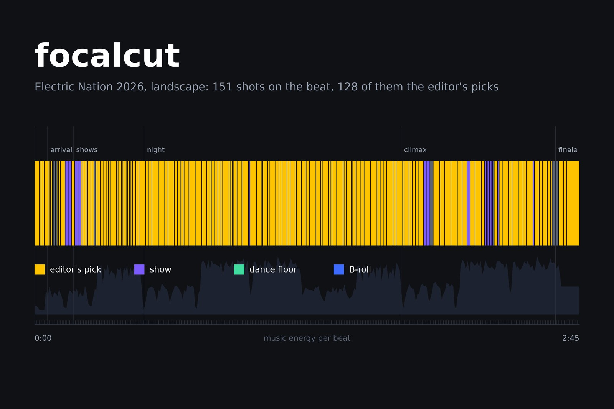

# focalcut

**Cut dance and event footage by who the camera is following — per-subject clips, beat-synced recap reels and
editor timelines.**

[](https://www.python.org/downloads/)
[](LICENSE)
[](https://isaacrowntree.github.io/focalcut/)



**[Documentation](https://isaacrowntree.github.io/focalcut/)** · [Write-up](https://zackdesign.biz/focalcut/) · [Changelog](CHANGELOG.md)

Point focalcut at dance footage — or any video where the camera moves between subjects —
and it finds the cuts where focus changes from one person or couple to the next, then
exports per-subject clips and a timeline you can open in Premiere, DaVinci Resolve,
Final Cut or Avid.

From a curated folder it also builds **recap reels**: a landscape and a portrait cut on the music's beats, told
in acts, with velocity edits, transitions, portrait reframing that follows a dancer, shake checks, effects and an
optional audio-reactive light-show overlay — plus a Premiere XML of each and a browser page for choosing,
trimming and reframing shots (see [Recap reels](#recap-reels-recipe)). The editor's picks always win: the
planner cuts around them, never over them ([The editor's picks](https://isaacrowntree.github.io/focalcut/picks.html)).

The recommended pipeline is **GPU-free**: ffmpeg contact sheets read by a vision model.

## Why this is hard (and how it works)

The core difficulty is **identity under bad conditions**: stage lighting washes every
dancer the same colour, lens flare swallows the subject, and dancers spin away from the
camera. Naive signals fail — frame-differencing over-cuts on every spin, and colour or
even CLIP-embedding similarity cannot tell two magenta-lit couples apart. (A SAM 3
detector plus appearance tracker was tried and under-segmented crowded floors; it
remains as the optional `cut --engine image|video` path.)

**What actually works is a contact sheet read by a vision model.** One thumbnail every
N seconds is the most legible identity signal there is — a vision model reading the grid
reasons about clothing, hair, faces and recurrence the way no box metric can. The
library pipeline is coarse → fine → ultra, all built from cheap ffmpeg contact sheets:

1. **Coarse** — one thumbnail every ~8 s per clip; a judge reads each and returns
   candidate cut points.
2. **Refine** — a ±8 s sheet at 2 s spacing around each candidate verifies it is a real
   couple change (not flare, a spin, or partner rotation) and gives a ~2 s boundary.
3. **Ultra** — a ±3 s sheet at 0.5 s spacing pins each boundary to ~0.5 s.
4. **Miss-sweep** — a skeptical second read of the single-segment clips catches any
   handoff the coarse pass missed.

The judge is a vision model fanned out one agent per sheet (Claude, via the scripts in
`workflows/`). On a 50-clip portrait dance library this ran in **~7 minutes total** and
pinned 26 cuts to 0.5 s.

## Install

Requires Python ≥3.10 and `ffmpeg`/`ffprobe` on `PATH`.

```bash
pip install "git+https://github.com/isaacrowntree/focalcut"
```

That is the full GPU-free pipeline — numpy, OpenTimelineIO and ffmpeg, nothing else.

<details>
<summary>Optional: the SAM 3 engines</summary>

`focalcut cut` uses SAM 3 (`facebook/sam3`), a **gated** model — accept its licence on
Hugging Face and `hf auth login` first. A CUDA GPU is recommended. This pulls torch and
transformers (~2.5 GB), which is why it is opt-in:

```bash
pip install "focalcut[sam] @ git+https://github.com/isaacrowntree/focalcut"
```

</details>

## Usage

### 1. Build contact sheets for a folder of clips

```bash
focalcut library "/path/to/footage" --interval 8 --portrait-only
```

Writes `focalcut/sheets/*.jpg`, a `sheets.json` job list, and a skeleton
`library.json` manifest with the cuts left blank.

### 2. Let a vision judge fill in the cuts

Fan out an agent per sheet using the four passes in `workflows/`
(`01-coarse-judge` → `02-refine-cuts` → `03-miss-sweep` → `04-ultra-boundary`). The
finished `library.json` holds, per clip, `cuts` (seconds), `segments`, and `notes`
describing each couple so a human can verify them.

### 3. Export a timeline

```bash
focalcut export "/path/to/footage"                 # FCP7 XML (default)
focalcut export "/path/to/footage" -f edl          # CMX 3600
focalcut export "/path/to/footage" -f aaf          # Avid Media Composer
focalcut export "/path/to/footage" -f otio         # OpenTimelineIO
focalcut formats                                   # what your install can write
```

| format | extension | opens in |
| ------ | --------- | -------- |
| `fcp7` | `.xml`    | Premiere Pro, DaVinci Resolve, Final Cut 7 |
| `aaf`  | `.aaf`    | Avid Media Composer |
| `edl`  | `.edl`    | anything (relink media after import) |
| `otio` | `.otio`   | any OTIO-aware tool; lossless round-trip |

Timelines are built as [OpenTimelineIO](https://opentimelineio.readthedocs.io) objects
and written through its adapters, so drop-frame timecode, NTSC 1000/1001 rates and
mixed-rate source conform are handled by the interchange library the post industry
already maintains — not by a bespoke XML writer here.

`--windows-paths` (on by default) maps WSL `/mnt/d/...` to `D:/...` so a cut made in WSL
opens in Premiere on Windows. Turn it off with `--no-windows-paths`.

### One-off contact sheet

```bash
focalcut sheet "clip.mp4" --interval 10
```

### Direct cut (optional SAM 3 engines)

```bash
focalcut cut "clip.mp4" --clips          # -> clip_dancers/ + clip.focalcut.xml
focalcut cut "/folder" --engine image --clips --copy
```

## Recap reels (recipe)

Once a folder is cut and curated, `focalcut reel` builds beat-synced highlight reels from it — a landscape
cut and a portrait cut, each up to Instagram's 3-minute Reels-tab limit — plus a Premiere timeline for each so
you can keep editing from the original camera files.

```bash
pip install "focalcut[reel] @ git+https://github.com/isaacrowntree/focalcut"
focalcut reel init "/footage/Show 2026" --song "track.mp3" \
    --stinger-landscape end_16x9.mov --stinger-portrait end_9x16.mov
focalcut reel run "/footage/Show 2026"        # units -> score -> shake -> focus -> subject -> … -> xml -> review
```

It reads your curated `export/<category>/` folders (category names set each clip's role: `segments` are
dancing, `broll` is B-roll, anything else is a show) and finds who each shot is about — SAM 3 person masks
scored by BiRefNet saliency and Depth Anything V2 nearness, so a dancer in motion blur still beats a sharp
bystander. Every shot is reframed around that subject (a 4K source can be cropped 1.6× for a 1080p reel), and
moments where the head is cut off by the camera's frame are marked down. It ranks moves — spins, dips, tricks,
hip shakes (SigLIP 2 on the subject's crop), close-ups with strong expressions — and cuts a story in acts to
the beat: an opening on the festival with the event's logo, the day's arrival, the shows, the night, a climax
of short cuts and speed ramps, and a finale. It cuts the way music videos are cut:
- shot lengths in varied 8-beat phrases that follow the music, rather than one length over and over
- move peaks on the beat, and cuts a couple of frames ahead of it
- every clip used, its shots shuffled through the others like a card shuffle
- each cut carrying the movement on: a turn into a turn, travel continuing the same way
Speed ramps are velocity edits: fast through the move (never above 1.5x on dancing), slowing to land exactly as
the dancer does, holding so hair and faces play out, then easing back up. Most cuts are hard cuts on the beat; each
act has a short vocabulary of transitions, and one goes in only where the cut has a reason (a spin cut between two
turns, a swipe when the same travel carries across, a push in to a face, a flash on a big hit). Camera shake is
measured, so shaky stretches give way to steadier ones and mildly shaky shots are stabilised. In portrait the strip
follows one dancer of a couple dancing apart and favours faces over backs. Band players cut in on the musical hits,
and the reel can end on a shot you choose. See [docs/recipes/recap-reel.md](docs/recipes/recap-reel.md), [docs/hardware.md](docs/hardware.md) for what runs on which chip, and
[docs/picks.md](docs/picks.md) for the review pages, `picks.json`, review rounds and reel.json profiles.

Every one of these is a reusable piece. `plan.place()` turns any hand-built sequence of shots into a plan that
renders and exports like a reel, so a teaser, a highlight or a promo uses the same rules (see
[skills/focalcut/examples/teaser.py](skills/focalcut/examples/teaser.py)). [skills/focalcut](skills/focalcut/SKILL.md)
is a Claude Code skill that lists each concept with the code behind it. To install it, run
`mkdir -p ~/.claude/skills && ln -s "$PWD/skills/focalcut" ~/.claude/skills/focalcut` from a clone
(the skill is not part of the pip package).

The effects are standalone modules too:

```bash
focalcut fx list
focalcut fx apply clip.mp4 -e hero,neon --peak 1.2
focalcut fx gallery clip.mp4                  # every effect side by side
```

## Benchmark

`bench/` scores predicted cuts against hand-labelled ground truth — boundary
precision/recall, over/under-segmentation, and a `manual_corrections_per_min`
"how much re-cutting is left" number. See `bench/data/README.md`.

## Contributing

See [CONTRIBUTING.md](CONTRIBUTING.md). Issues and PRs get a reply within a week.

## Security

See [SECURITY.md](SECURITY.md). The review server answers localhost only.

## License

MIT — see [LICENSE](LICENSE). SAM 3 model weights are under Meta's separate SAM
Licence; review it before using the `[sam]` engines.

focalcut is not affiliated with or endorsed by Adobe, Apple, Avid, Blackmagic Design or Meta. Premiere Pro,
Final Cut Pro, Media Composer, DaVinci Resolve and SAM are trademarks of their owners.
